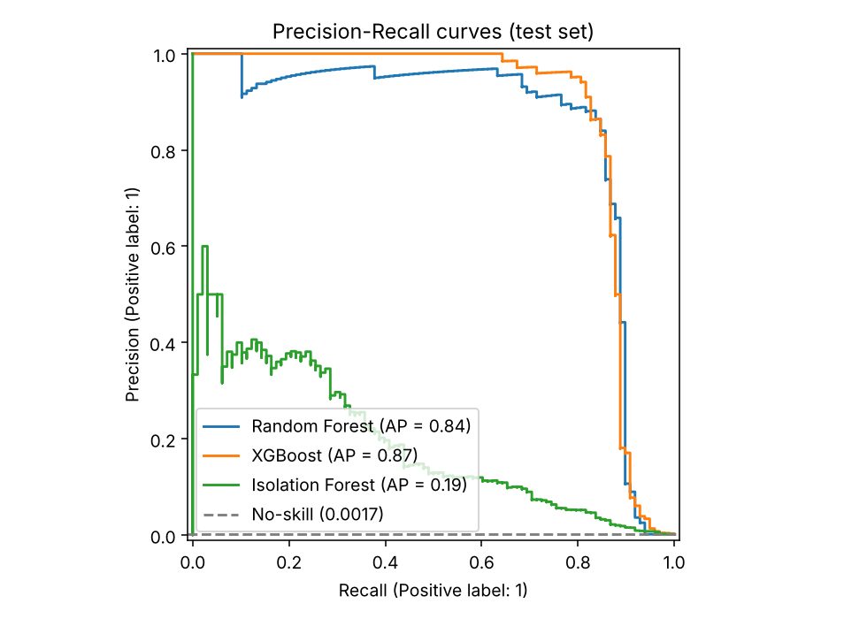
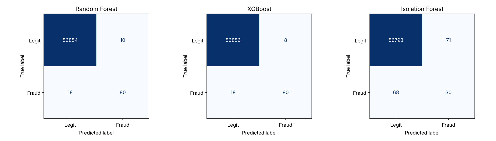
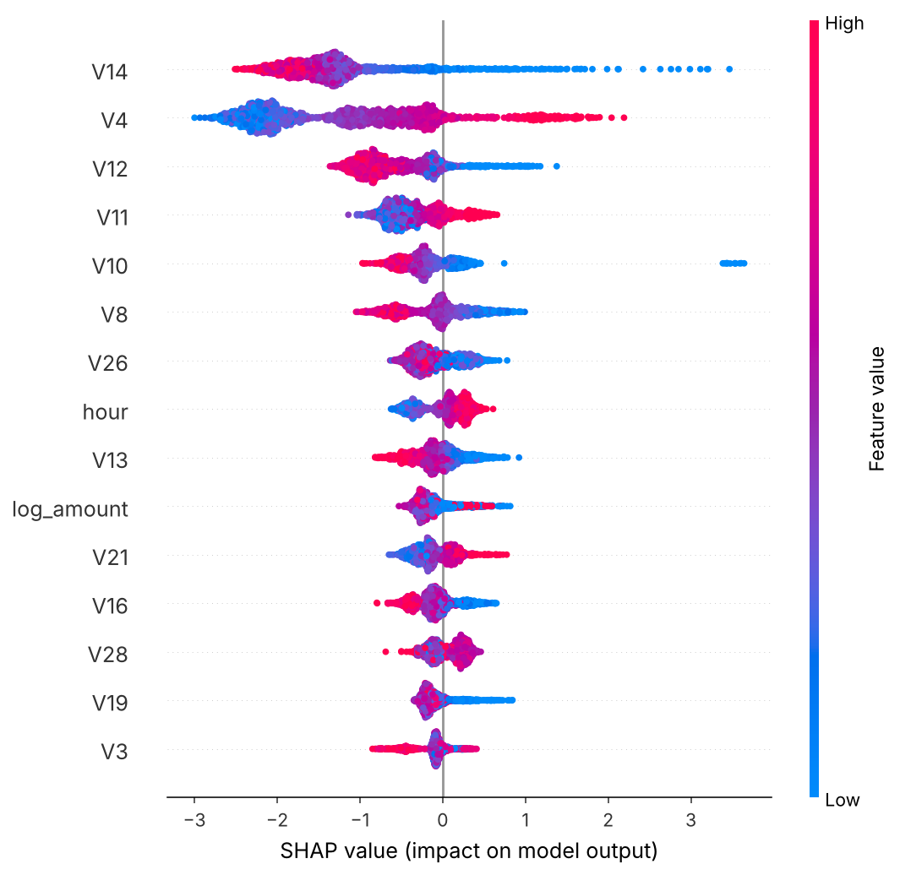
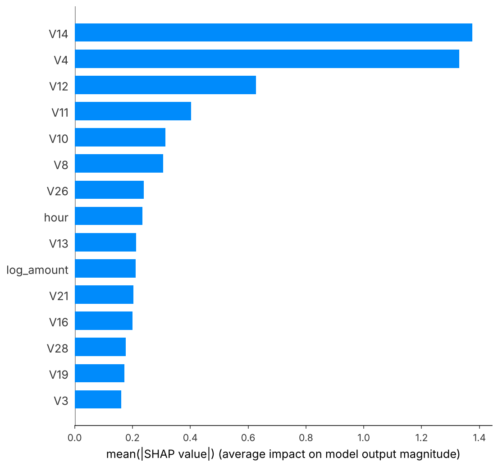

# 💳 Real-Time Credit Card Fraud Detection

[](https://github.com/YOUR_USERNAME/fraud-detection/actions)


End-to-end ML project that predicts fraudulent card transactions on a **highly imbalanced** dataset, compares **Random Forest, XGBoost and Isolation Forest**, explains predictions with **SHAP**, and serves them through a **real-time FastAPI** service backed by a **SQL** audit log.

**Stack:** Python · scikit-learn · XGBoost · SHAP · FastAPI · Pydantic · SQLite/SQL · pytest · Docker · GitHub Actions

---

## Highlights

| Requirement | How it is handled |
|---|---|
| Predict fraudulent transactions | Supervised (RF, XGBoost) and unsupervised (Isolation Forest) detectors |
| Highly imbalanced data (~0.2% fraud) | Stratified splits, class weighting (`balanced_subsample`, `scale_pos_weight`), PR-AUC as the primary metric, F1-optimal threshold tuned on a **validation** set |
| Compare 3 models | Same splits, same features, same threshold procedure → `reports/model_comparison.md` |
| Real-time API | `POST /predict` (single), `POST /predict/batch`, optional `?explain=true` SHAP reasons, health/stats endpoints |
| SQL | Exploratory analysis with window functions (`sql/`), plus a prediction audit table written by the API |
| Engineering | Shared feature code (no train/serve skew), input validation, tests, CI, Dockerfile |

## Results

Dataset: [ULB Credit Card Fraud Detection](https://www.kaggle.com/datasets/mlg-ulb/creditcardfraud) — 284,807 transactions, 492 frauds (**0.173%**). Split 64% fit / 16% validation / 20% test (stratified). Thresholds and the XGBoost class weight are chosen on validation data only; the numbers below are on the untouched test set (56,962 transactions, **98 frauds**).

| Model | PR-AUC | ROC-AUC | Precision | Recall | F1 | Recall @ 1% FPR | Train time |
|:--|--:|--:|--:|--:|--:|--:|--:|
| Random Forest | 0.843 | 0.965 | 0.889 | 0.816 | 0.851 | 0.898 | 135.5 s |
| **XGBoost** | **0.871** | **0.982** | **0.909** | 0.816 | **0.860** | **0.908** | 11.2 s |
| Isolation Forest (unsupervised) | 0.192 | 0.955 | 0.297 | 0.306 | 0.302 | 0.653 | 2.1 s |

Takeaways:

- **XGBoost ≥ Random Forest ≫ Isolation Forest.** The supervised models exploit the labels; Isolation Forest, which never sees them, flags unusual transactions rather than fraudulent ones. Note its ROC-AUC (0.955) looks fine while its PR-AUC (0.19) exposes how many false alarms it produces — a good illustration of why ROC-AUC misleads under imbalance.
- **Naively "balancing" hurt XGBoost.** Weighting fraud by the full class ratio (~578×) made boosting stop after 26 trees (validation PR-AUC 0.727); a milder √-ratio weight gave 0.811 and no re-weighting gave 0.848 (250 trees), so the pipeline selected that one. Random Forest, in contrast, works well with `balanced_subsample`.

  | XGBoost `scale_pos_weight` | Validation PR-AUC | Trees |
  |:--|--:|--:|
  | 577.7 (full ratio) | 0.727 | 26 |
  | 24.0 (√ ratio) | 0.811 | 57 |
  | 1.0 (none) | **0.848** | 250 |

- **Small-sample caveat:** with 98 test frauds, one extra caught fraud moves recall by ~1 point, so the RF-vs-XGBoost gap is within noise. Cross-validation (see roadmap) would quantify it. The dataset also contains ~1,000 duplicate rows, which may slightly inflate scores if duplicates straddle the split.

<p align="center">
  
  
</p>

### Explainability (SHAP)

SHAP on the serving model (XGBoost) shows `V14`, `V4`, `V12`, `V11` and `V10` as the strongest drivers; for example, low `V14` values push the fraud score up. The components are anonymised PCA outputs, so they identify *where* the signal is, not a human-readable reason.

<p align="center">
  
  
</p>

## Why PR-AUC and not accuracy?

Predicting "legitimate" for everything is 99.8% accurate and catches zero fraud. Precision–Recall metrics focus on the rare class: *how many alerts are real* (precision) versus *how much fraud is caught* (recall). ROC-AUC is reported too but looks optimistic under heavy imbalance.

## Project structure

```
├── src/fraud_detection/
│   ├── config.py        # paths, column names
│   ├── data.py          # Kaggle loader + synthetic generator (same schema)
│   ├── features.py      # shared feature engineering (log_amount, hour)
│   ├── models.py        # RF / XGBoost / Isolation Forest definitions
│   ├── evaluate.py      # PR-AUC, threshold tuning, recall@FPR, confusion counts
│   ├── explain.py       # SHAP plots + per-transaction top factors
│   ├── train.py         # end-to-end training & comparison pipeline
│   └── api/             # FastAPI app, schemas, model service, SQLite audit log
├── sql/                 # schema, EDA queries (window functions), monitoring queries
├── scripts/             # sql_analysis.py, simulate_stream.py
├── tests/               # pytest: data, metrics, training, API
├── reports/             # comparison table + figures (committed for the README)
├── Dockerfile · Makefile · .github/workflows/ci.yml
```

## Quick start

```bash
git clone https://github.com/YOUR_USERNAME/fraud-detection.git && cd fraud-detection
python -m venv .venv && source .venv/bin/activate      # Windows: .venv\Scripts\activate
pip install -e ".[dev]"

python -m fraud_detection.train        # trains 3 models (~3 min on the full dataset), writes models/ and reports/
pytest -q                              # 12 tests
uvicorn fraud_detection.api.main:app --reload
```

Interactive docs: <http://localhost:8000/docs>

### Data

Place `creditcard.csv` ([Kaggle](https://www.kaggle.com/datasets/mlg-ulb/creditcardfraud)) in `data/` (git-ignored). If the file is missing, the pipeline falls back to a synthetic dataset with the same schema so tests, CI and Docker builds run without it.

## API

```bash
curl -X POST "http://localhost:8000/predict?explain=true" \
  -H "Content-Type: application/json" \
  -d '{"transaction_id":"txn-1","Time":52000,"Amount":129.99,"V1":0,"V2":0, ... "V28":0}'
```

```json
{
  "transaction_id": "txn-1",
  "fraud_probability": 0.9999,
  "is_fraud": true,
  "risk_level": "high",
  "threshold": 0.3042,
  "model": "xgboost",
  "latency_ms": 3.5,
  "top_factors": [
    {"feature": "V14", "value": -4.75, "shap_value": 3.81, "direction": "increases_risk"}
  ]
}
```

| Endpoint | Purpose |
|---|---|
| `POST /predict` | Score one transaction (`?explain=true` adds top-5 SHAP factors) |
| `POST /predict/batch` | Score up to 1,000 transactions |
| `GET /model-info` | Serving model, threshold, test metrics |
| `GET /stats` | Totals and flag rate from the SQL audit log |
| `GET /health` | Liveness + model-loaded check |

`risk_level`: **high** ≥ tuned threshold, **medium** ≥ half the threshold, otherwise **low**. Scoring takes roughly 3–6 ms per transaction on a laptop-class CPU in local testing (without SHAP); `explain=true` costs more.

Every prediction is logged to `data/predictions.db` (SQLite) off the request path via a background task.

### Simulate a live stream

```bash
uvicorn fraud_detection.api.main:app &
python scripts/simulate_stream.py --n 50 --delay 0.2
```

(The demo stream is sampled from the full dataset, which includes training rows, so it demonstrates the plumbing, not generalisation. Fraud is over-sampled to 20% for visibility.)

## SQL

```bash
python scripts/sql_analysis.py --load     # loads data into data/fraud.db and runs sql/eda_queries.sql
```

Queries cover class balance (`SUM() OVER ()`), fraud rate by hour of day, amount buckets/deciles (`NTILE`), and a rolling 6-hour fraud rate (window frame). `sql/monitoring_queries.sql` contains production-style queries against the API's `predictions` table.

## Docker

```bash
docker build -t fraud-api . && docker run -p 8000:8000 fraud-api
```

## Design decisions & limitations

- **Threshold tuning on validation, not test** — avoids optimistic leakage. In production the threshold should come from business costs (cost of a missed fraud vs. a false alarm), not F1.
- **Random split.** The dataset spans two days; a time-based split is more faithful to deployment and is a good next step.
- **Isolation Forest never sees labels**, so it is a fair "no labels available" baseline; it trails the supervised models by a wide margin here (PR-AUC 0.19 vs 0.84–0.87).
- **Features are anonymised PCA components**, so SHAP explanations identify *which* components drive risk, not human-readable reasons.
- **Not production-ready security-wise:** no auth, rate limiting, or PII handling; SQLite should be replaced by a real database.

## Roadmap

- [ ] Time-based split and stratified k-fold CV with confidence intervals
- [ ] SMOTE / under-sampling comparison against class weights (the XGBoost weight search above is a first step)
- [ ] Probability calibration + cost-based threshold
- [ ] Drift monitoring on the `predictions` table
- [ ] Authentication and Postgres

## License

MIT
